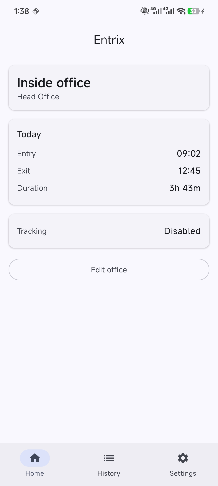
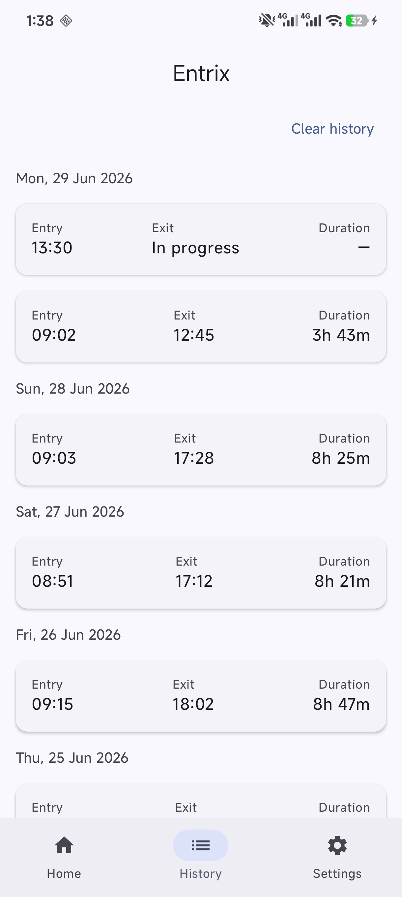
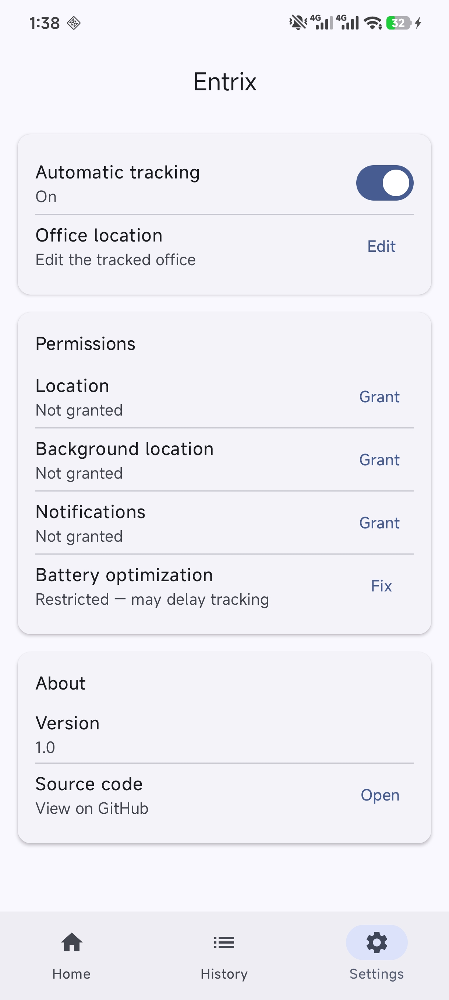
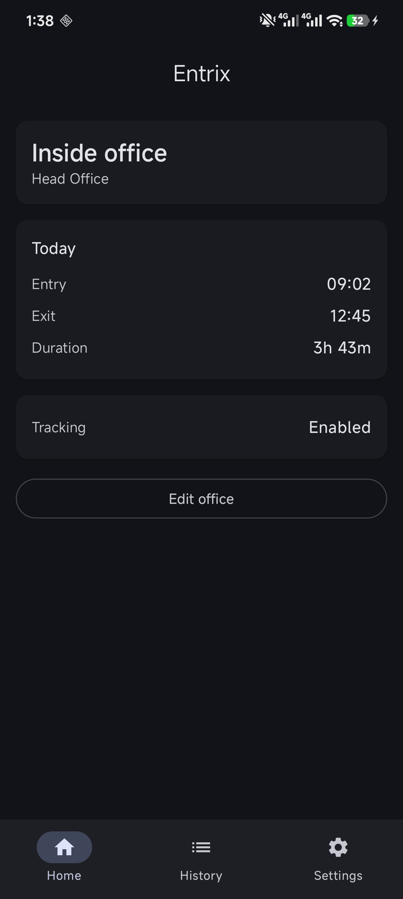
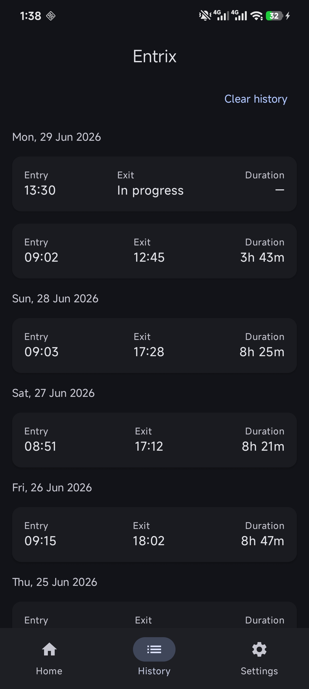
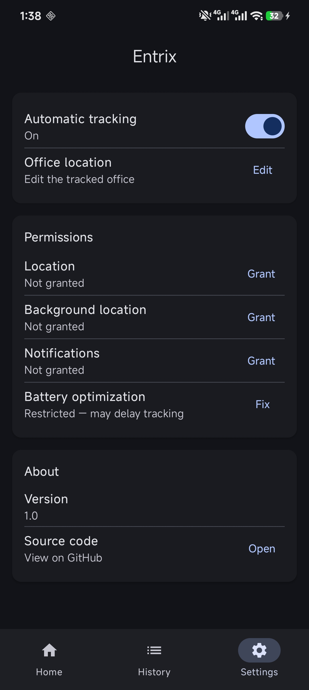
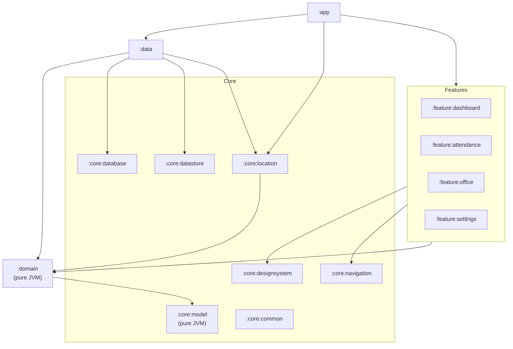

# Entrix

**Automatic Place & Attendance Tracker**

Entrix is a privacy-first Android app that automatically records when you enter and leave a configured location (your office) using the Android Geofencing API — no account, no cloud, no analytics, no ads. Everything stays on the device.

[](https://github.com/Nahian98/Entrix/actions/workflows/ci.yml)


> ⚠️ Portfolio / work-in-progress. The app is functionally complete and fully builds; it has not yet been hardened for a Play Store release (R8/signing) — see the [Roadmap](#roadmap).

---

## Why it exists

Most attendance apps want a login, a server, and your data. Entrix is the opposite: a small, polished, **offline-first** tool that quietly logs your office hours on-device. It doubles as a demonstration of production-grade, modern Android engineering — clean architecture, strict modularization, convention-plugin Gradle, and a fully unit-tested domain layer.

## Features

- 📍 Configure a single office location and geofence radius
- 🟢 Automatic, battery-friendly **entry / exit detection** via geofencing (no continuous polling, no foreground service)
- 🕓 Local attendance history with per-day grouping and durations
- 🗑️ Delete history; edit the configured office
- 🔒 100% local — no account, no network, no tracking
- 🎨 Material 3 UI with dynamic color, light/dark themes
- 🔁 Geofences automatically restored after device reboot

## Screenshots

Material 3 UI with full light & dark theme support (and Material You dynamic color).

| Dashboard | History | Settings |
|:---:|:---:|:---:|
|  |  |  |
|  |  |  |

---

## Architecture

Entrix follows **Clean Architecture** with **MVVM** and **unidirectional data flow**, split into a feature-first multi-module structure. Dependencies always point inward: features and data depend on the domain; the domain depends on nothing Android.



Key rule: **`:domain` and `:core:model` are pure Kotlin/JVM modules** — they cannot even compile against the Android SDK. Business logic is therefore unit-testable with plain JUnit, no Robolectric or emulator required.

### Module responsibilities

| Module | Type | Responsibility |
|---|---|---|
| `:app` | app | Application, Koin start-up, navigation host, theme entry, composition root |
| `:feature:dashboard` | android-lib | Current status + today's summary |
| `:feature:attendance` | android-lib | History list, grouped by day; delete |
| `:feature:office` | android-lib | Office picker (location + radius) |
| `:feature:settings` | android-lib | Tracking toggle, permissions, battery, about |
| `:domain` | **JVM** | Entities-adjacent models, repository interfaces, use cases |
| `:data` | android-lib | Repository implementations, entity↔model mappers, DI |
| `:core:model` | **JVM** | Shared domain models (`Office`, `Attendance`, …) |
| `:core:common` | android-lib | Dispatchers, `AppResult`, shared utilities |
| `:core:designsystem` | android-lib | Theme, spacing, reusable Compose components |
| `:core:navigation` | android-lib | Type-safe navigation routes |
| `:core:database` | android-lib | Room database, DAOs, entities (schema exported) |
| `:core:datastore` | android-lib | Preferences DataStore |
| `:core:location` | android-lib | Geofencing client, broadcast receivers, fused location |

---

## Tech stack

| Concern | Choice |
|---|---|
| Language | Kotlin (coroutines, `StateFlow`) |
| UI | Jetpack Compose, Material 3, Navigation Compose (type-safe) |
| DI | **Koin** |
| Persistence | Room (single source of truth) + DataStore |
| Location | Android Geofencing API + Fused Location Provider |
| Build | Gradle Kotlin DSL, Version Catalog, **`build-logic` convention plugins** |
| Testing | JUnit, Coroutines Test, Turbine, MockK |

### Engineering highlights

- **Convention plugins (`build-logic/`)** — every module's build script is a few lines; shared config (`compileSdk`, Compose, Room, feature wiring) lives in `entrix.android.*` / `entrix.jvm.library` plugins. No copy-pasted Gradle.
- **Pure-JVM domain** — framework independence enforced by the module boundary, not just convention.
- **Single source of truth** — Room exposes `Flow`; the UI derives immutable state from it.
- **Privacy by construction** — no networking dependency exists anywhere in the graph.

---

## How geofencing works

Entrix never polls location. It registers a single geofence and reacts to OS-delivered transitions. To stay accurate **and** avoid logging drive-bys or GPS jitter at the boundary, it uses a deliberate reconciliation policy (`RecordGeofenceTransitionUseCase`):

```
ENTER  →  cache the precise crossing time (persisted, survives process death)
DWELL  →  open a visit, back-dated to the cached ENTER time
EXIT   →  close the open visit; discard any unconfirmed ENTER
```

A visit is only created once the user has **dwelled** (~2 min) inside the region — so a brief pass near the boundary leaves no record — yet `enterTime` is still the real moment of entry because the ENTER timestamp was cached. Every branch is idempotent, so duplicate transitions can't corrupt state. This logic is covered by unit tests.

Geofences are re-registered on boot, transitions are handled in a `BroadcastReceiver` via `goAsync()` (no foreground service), and Google Play Services availability and permission revocation are handled gracefully.

> **Note on the location picker:** the office is selected via *"use my current location"* + editable coordinates + a radius slider, behind an abstraction. A Google Maps SDK picker can be slotted in without touching the domain or data layers — it was kept optional to keep the app free of a billing-gated API key and true to its zero-cloud ethos.

---

## Building

Requirements: **JDK 17+** (the build targets Java 17; Android Studio's bundled JBR 21 works) and the Android SDK.

```bash
# Point JAVA_HOME at a JDK 17+ (e.g. Android Studio's JBR), then:
./gradlew assembleDebug          # build the debug APK
./gradlew :domain:test           # run the pure-JVM domain tests
./gradlew testDebugUnitTest      # run all JVM unit tests
./gradlew installDebug           # install on a connected device/emulator
```

No API keys or `local.properties` secrets are required to build or run.

## Testing

- **24 JVM unit tests** across `:domain` and `:data` — including full coverage of the geofence reconciliation policy, office validation, the dashboard aggregation, and persistence mappers.
- An **instrumented Room DAO test** (open/close a visit, foreign-key cascade) — run on a device with `./gradlew connectedDebugAndroidTest`.
- Room validates all DAO SQL **at compile time** via KSP, and the database schema is exported to `core/database/schemas/` for migration review.

---

## Roadmap

- [ ] Screenshots + on-device verification pass
- [ ] Release hardening (R8/minify, ProGuard rules, release signing)
- [ ] CI (GitHub Actions: build + tests + lint) and a Koin graph `verify()` check
- [ ] Optional Google Maps picker
- [ ] Future platform ideas (kept architecturally open, not yet implemented): multiple places, statistics, widgets, backup/restore, Wear OS

## License

MIT — see `LICENSE`. (Add a `LICENSE` file if one isn't present yet.)
